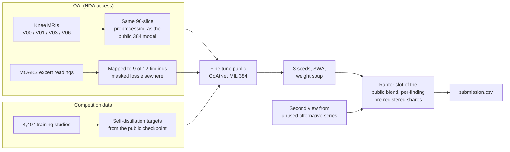

# RSNA Knee Abnormality Detection: OAI expert-reading fine-tune

Solution code and notes for the Kaggle [RSNA Knee Abnormality Detection](https://www.kaggle.com/competitions/rsna-knee-abnormality-detection)
competition (2026): predict 12 abnormalities per knee MRI study, scored by macro ROC AUC.

**Result: bronze medal. Private LB 0.943, rank 325 of 6,299 teams (top 5.2%, final standings). Public LB 0.959.**
Built in the last ten days of a two-month competition, on Kaggle GPUs plus about $50 of rented GPU time.

## What this repo shows

- **External expert labels, mapped carefully.** Osteoarthritis Initiative (OAI) knee MRIs with MOAKS expert readings
  were mapped onto the competition's five-series layout and nine of its twelve findings (7,988 labelled
  knee-visits), with byte-for-byte checks of the preprocessing and regression tests for the label mapping. Two
  independent reviews found and fixed real mapping errors before training.
- **Controlled experiments.** Every new-data run had a matched control (same start checkpoint, seed and steps) and a
  fixed subject-level holdout, so the effect of the OAI labels could be measured, not guessed.
- **Safe integration into a strong public ensemble.** Weight-space averaging of three seeds, pre-registered blend
  weights, per-study success masks and time guards so a failing stage falls back to the public base.
- **Honest post-mortem.** What helped, what did not, and why the private score dropped more than the leaders'.

## Approach



Details: [docs/SOLUTION.md](docs/SOLUTION.md).

## Key results

Controlled test (same start, seed and steps; macro ROC AUC):

| Model (SWA) | 58 gold-labelled studies | OAI holdout (375 knees) |
|---|---|---|
| Public release checkpoint | 0.9226 | 0.9207 |
| G0: competition targets only | 0.9229 | 0.9134 |
| G1: + corrected OAI MOAKS | **0.9257** | **0.9306** |
| 3-seed G1 weight soup | 0.9278 | 0.9375 |

Leaderboard (public = 30% of the hidden test, private = 70%):

| Submission | Public | Private |
|---|---|---|
| Public 0.9576 base ensemble | 0.957 | 0.941 |
| Base + G0 control / + G1 | 0.957 / 0.957 | 0.942 / 0.942 |
| Final: updated base + G1-G3 soup + second view | **0.959** | **0.943** |
| Soup alone (no base models) | 0.949 | 0.933 |

The OAI labels clearly helped on both held-out validation sets. On the hidden test their effect was below the
leaderboard's three-decimal precision.

## Post-mortem

- Everyone lost about 0.01 from public to private. This entry lost 0.016, exactly as much as the public base
  ensemble it was built on; that base's per-finding weights had been chosen on the public leaderboard.
- 248 teams scored at least 0.959 on the public leaderboard, many with the same public base, so a public rank of 218
  overstated the position.
- The top solutions rebuilt the training labels with vision LLMs that read the images and trained their own
  0.954-0.958 models on them ([docs/TOP_SOLUTIONS.md](docs/TOP_SOLUTIONS.md)); we built on public labels and models.
- Lessons for the next competition: decide on a trusted local validation set, treat public-LB differences below
  ~0.002 as noise, and start early enough to own the base models. See [docs/LESSONS.md](docs/LESSONS.md).

## Repository layout

| Path | Contents |
|---|---|
| `src/knee/` | Preprocessing (96-slice CoAtNet layout, OAI series mapping), MOAKS label mapping, fine-tuning and evaluation code |
| `scripts/` | OAI selection / download / cache pipeline, training runners, evaluators, the inference notebook builder (`build_oai_infer_notebook.py`, which adds these stages to a public base notebook), output checks |
| `kaggle/kernels/` | Cache-building and evaluation kernels; `scripts/push_kernel.sh` prepends `kaggle/kaggle_paths.py` (path helpers) and any `overrides.py` before pushing |
| `tests/` | Regression tests: `PYTHONPATH=src python -I tests/<file>.py` |
| `docs/` | `SOLUTION.md` (write-up), `EXPERIMENT_LOG.md` (every result), `LESSONS.md`, `COMPETITION.md`, `RESEARCH_NOTES.md` |

## Reproducing

```bash
python3 -m venv .venv
.venv/bin/pip install -r requirements.txt
for t in tests/*.py; do PYTHONPATH=src .venv/bin/python -I "$t"; done
```

No competition data, OAI images, OAI-derived labels or model weights are included. The competition data are
available on Kaggle under its rules; OAI data require your own NDA data use certification. The inference notebooks
are rebuilt from the public base notebooks (credited below) with `scripts/build_oai_infer_notebook.py`.

## Acknowledgements

Built on public work with thanks: dreaddevelopment's Raptor CoAtNet/MIL recipe; nartaa's published SWA weights and
inference notebooks (384 anatomical mirror, 224 crop); heliosli's R6 bundle and blend notebooks; goodpjw2008's 2.5D
ConvNeXt reader (Apache 2.0); the public report-label sets of stevenleehans, pilkwang and riadmohamed42.

Data and/or research tools used in the preparation of this work were obtained and analyzed from the controlled access
datasets distributed from the Osteoarthritis Initiative (OAI), a data repository housed within the NIMH Data Archive
(NDA). OAI is a collaborative informatics system created by the National Institute of Mental Health and the National
Institute of Arthritis, Musculoskeletal and Skin Diseases (NIAMS) to provide a worldwide resource to quicken the pace
of biomarker identification, scientific investigation and OA drug development. Dataset identifier(s): NDA Study 3427, DOI [10.15154/cb9j-k762](https://doi.org/10.15154/cb9j-k762).

## License

Code: [MIT](LICENSE). Documentation and results may be reused with attribution. This license does not cover the
competition data, OAI data or the public models and notebooks credited above, which keep their own terms.
